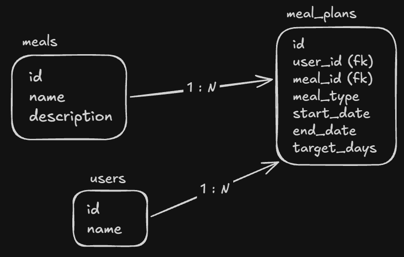

# Food Calendar API

API REST para gerenciar usuários, cadastrar refeições e organizar um calendário alimentar. Cada plano vincula uma refeição a um usuário e define o período e os dias da semana em que ela será servida.

Frontend desenvolvido por `@ogusmello`. [Repositório do frontend](https://github.com/ogusmello/foodcalendar-fe)

[Como executar](#como-executar) · [Endpoints](#endpoints) · [Modelo de dados](#modelo-de-dados) · [Testes](#testes)

## Tecnologias

- Java 25 e Spring Boot 4.1.1
- Spring Web MVC, Spring Data JPA e Jakarta Validation
- PostgreSQL 16 e Docker Compose
- Swagger UI e OpenAPI
- JUnit, Mockito e Testcontainers

## Como executar

### Pré-requisitos

- **Docker** com Docker Compose.
- **JDK 25**, caso queira executar a API localmente com o Maven Wrapper.

O arquivo [`.env.example`](.env.example) documenta as variáveis de ambiente necessárias para configurar a aplicação.

### Opção 1 - API e PostgreSQL com Docker Compose

Na raiz do projeto, copie o arquivo `.env.example` para `.env` e configure as variáveis conforme o exemplo abaixo.

```dotenv
DATABASE_HOST=localhost
DATABASE_HOST_DOCKER=postgres-db
DATABASE_PORT=5432
DATABASE_NAME=name_exemplo
DATABASE_USERNAME=usuario_exemplo
DATABASE_PASSWORD=senha_local_de_exemplo
```

Substitua os valores de exemplo de nome, usuário e senha pelas credenciais que deseja utilizar no PostgreSQL.

Em seguida, execute o comando abaixo.

```bash
docker compose up -d --build
```

O Docker Compose construirá a imagem da API a partir do `Dockerfile` e iniciará os dois serviços.

- **PostgreSQL** - banco de dados da aplicação.
- **API** - aplicação Spring Boot, iniciada após o PostgreSQL passar na verificação de saúde.

### Opção 2 - API local com Maven Wrapper

Para desenvolver ou depurar a aplicação diretamente na IDE, é possível iniciar apenas o PostgreSQL no Docker e executar a API localmente.

**Windows (PowerShell)**

```powershell
$env:DATABASE_HOST = 'localhost'
$env:DATABASE_PORT = '5432'
$env:DATABASE_NAME = 'name_exemplo'
$env:DATABASE_USERNAME = 'usuario_exemplo'
$env:DATABASE_PASSWORD = 'senha_local_de_exemplo'

docker compose up -d --wait postgres-db
.\mvnw.cmd spring-boot:run
```

**Linux e macOS**

```bash
export DATABASE_HOST=localhost
export DATABASE_PORT=5432
export DATABASE_NAME=name_exemplo
export DATABASE_USERNAME=usuario_exemplo
export DATABASE_PASSWORD=senha_local_de_exemplo

docker compose up -d --wait postgres-db
./mvnw spring-boot:run
```

> **Observação:** os valores configurados no terminal devem corresponder aos definidos no arquivo `.env` utilizado pelo Docker Compose.

O Maven Wrapper utiliza a versão configurada do Maven, sem exigir uma instalação manual da ferramenta.

### Acessando a API

Com a aplicação em execução, os seguintes endereços estarão disponíveis.

A API ficará disponível em `http://localhost:8080`

- **Swagger UI** - [http://localhost:8080/swagger-ui/index.html](http://localhost:8080/swagger-ui/index.html)
- **OpenAPI** - [http://localhost:8080/v3/api-docs](http://localhost:8080/v3/api-docs)

### Encerrando os containers

Para parar e remover os containers da aplicação, execute o comando abaixo.

```bash
docker compose down
```

Os dados do PostgreSQL são preservados no volume Docker configurado para o projeto.

## Endpoints

Todas as rotas usam o prefixo `/v1`. As listagens retornam arrays sem paginação e as datas seguem o formato `YYYY-MM-DD`.

### Usuários

| Método | Rota | Operação | Sucesso |
| --- | --- | --- | --- |
| `GET` | `/v1/users` | Listar usuários | `200 OK` |
| `GET` | `/v1/users/{userId}` | Buscar usuário por ID | `200 OK` |
| `POST` | `/v1/users` | Cadastrar usuário | `201 Created` |
| `PUT` | `/v1/users/{userId}` | Atualizar o nome do usuário | `200 OK` |
| `DELETE` | `/v1/users/{userId}` | Excluir usuário e seus planos alimentares | `204 No Content` |

### Refeições

| Método | Rota | Operação | Sucesso |
| --- | --- | --- | --- |
| `GET` | `/v1/meals` | Listar refeições ou buscar por `name` | `200 OK` |
| `GET` | `/v1/meals/{mealId}` | Buscar refeição por ID | `200 OK` |
| `POST` | `/v1/meals` | Cadastrar refeição | `201 Created` |
| `PATCH` | `/v1/meals/{mealId}` | Atualizar nome ou descrição | `200 OK` |
| `DELETE` | `/v1/meals/{mealId}` | Excluir refeição e os planos que a utilizam | `204 No Content` |

O filtro `name` pesquisa por trecho do nome, sem diferenciar maiúsculas de minúsculas.

### Planos alimentares

| Método | Rota | Operação | Sucesso |
| --- | --- | --- | --- |
| `GET` | `/v1/meal-plans` | Listar planos por usuário, data ou período | `200 OK` |
| `GET` | `/v1/meal-plans/{mealPlanId}` | Buscar plano alimentar por ID | `200 OK` |
| `POST` | `/v1/meal-plans` | Criar plano alimentar | `201 Created` |
| `PATCH` | `/v1/meal-plans/{mealPlanId}` | Atualizar os campos informados do plano | `200 OK` |
| `DELETE` | `/v1/meal-plans/{mealPlanId}` | Excluir plano alimentar | `204 No Content` |
| `POST` | `/v1/meal-plans/clone` | Copiar os planos de um período | `201 Created` |

**Filtros da listagem**

- `userId` restringe a busca a um usuário; pode ser usado sozinho ou combinado com datas
- `date` retorna planos vigentes que incluem o dia da semana correspondente à data; tem prioridade sobre o filtro por período
- `startDate` e `endDate` quando informados juntos, retornam planos que estejam ativos em pelo menos um dia do 
  período pesquisado, incluindo o primeiro e o último dia

A clonagem seleciona os planos pelas datas exatas do período de origem e preserva a refeição, o tipo e os dias da semana. Se o usuário já tiver um plano com as datas exatas de destino, a API retorna `409 Conflict`.
## Modelo de dados

Cada plano (`meal_plans`) pertence a um usuário (`users`) e referencia uma refeição (`meals`). Usuários e refeições podem estar associados a vários planos.



## Testes

O projeto contém **testes unitários dos Services**, usando JUnit e Mockito para isolar dependências, e **testes de integração dos Repositories**, que verificam consultas JPA e persistência em um PostgreSQL temporário iniciado pelo Testcontainers.

Para executar os testes de integração, mantenha o Docker disponível. O banco dos testes é separado do PostgreSQL usado para desenvolver a aplicação.

| Escopo | Windows (PowerShell) | Linux e macOS |
| --- | --- | --- |
| Suíte completa | `.\mvnw.cmd test` | `./mvnw test` |
| Apenas serviços | `.\mvnw.cmd '-Dtest=*ServiceTest' test` | `./mvnw '-Dtest=*ServiceTest' test` |
